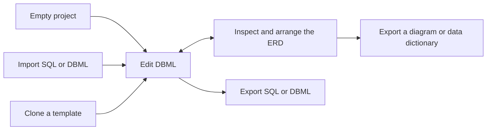
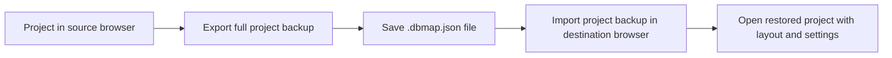

# DBMaps

DBMaps is a browser-based database schema designer. Write DBML, visualize tables and relationships on an interactive ERD canvas, import SQL, and export schemas, diagrams, or a Markdown data dictionary.

[Open DBMaps Studio](https://dbmaps.vercel.app/app) · [Browse templates](https://dbmaps.vercel.app/templates) · [Learn DBML](https://dbmaps.vercel.app/learn-dbml)

## Project overview

DBMaps is a Vue application built with Vite and deployed as a static site on Vercel. Parsing, diagram layout, and export run in the browser. The app stores projects and preferences in browser storage, so each browser profile and site origin has its own workspace.

## Workflows

### Design and export a schema

Start with an empty project, import SQL or DBML, or clone a template. Edit the schema in DBML, inspect the relationships on the canvas, and arrange tables manually or with auto-layout. Export SQL or DBML for development, an image or PDF for sharing, or a Markdown data dictionary for documentation.

### Back up and restore a project

Use **Export Full Project Backup** to download a `.dbmap.json` file containing the schema, diagram layout, and project settings. Use **Import Project Backup** in the destination browser to restore it as a separate project. Keep the backup file if you plan to clear browser storage or move to another device.

## Run locally

For the Windows offline desktop app, `.dbml` documents with layout, and installer
build instructions, see [Desktop](rust-desktop/README.md).

    bun install
    npm run dev

## Build and deploy

    npm run build
    npm run start

Vite writes the production build to `dist/`. The start command previews that build locally. Vercel uses `vercel.json` to serve the static build and route direct visits to app pages.
